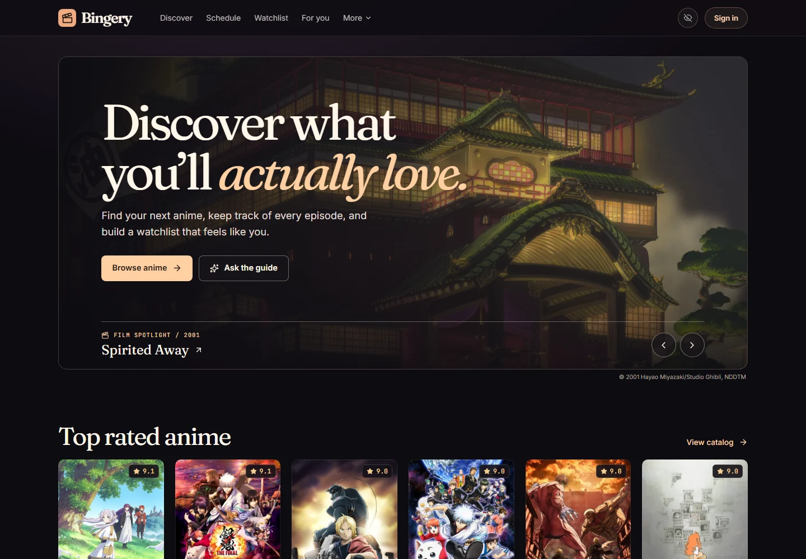

# Bingery

Bingery is an anime catalog, watchlist, and weekly release calendar. Find a series, save the episode you stopped on, and see when its next subtitled or English-dubbed episode is due.

[Open Bingery](https://bingery.fly.dev) · [See the catalog](screenshots/discover.png) · [Browse the feature reference](docs/FEATURES.md)



## Using Bingery

Start in **Discover**. Search by title, filter by genre, or sort by community score. The URL keeps your search and filters so you can bookmark a shortlist. Open a title for its synopsis, fan-genre votes, and related entries in viewing order.

Sign in to track your shows and use the weekly calendar.

| What you want to do | Where to go |
| --- | --- |
| Remember where you stopped | Open the title, set its watch status, and save the last episode you watched. **Watchlist** shows your progress across series. |
| Plan your week | In **Schedule**, choose sub or dub, move between weeks, or narrow the calendar to shows you follow. Estimated dub releases are labeled. |
| Find your next series | **For You** uses your ratings and watchlist to suggest titles. In **Guide**, describe a mood or ask for something similar to a favorite. |
| Share a lineup | Group titles in **Collections** and make a collection public to get a share link. Making it private again revokes the link. |

Visitors can explore the catalog before signing in. To save your own list on the hosted app, request an invitation from the sign-in page. After approval, follow the invitation and verify your email. To try tracking right away, use the local demo below.

## Run a local demo

Use Python 3.13 and Node.js 20 or later. Start in the repository root and activate a Python virtual environment.

**Windows PowerShell**

```powershell
py -3.13 -m venv .venv
.\.venv\Scripts\Activate.ps1
```

**macOS or Linux**

```sh
python3.13 -m venv .venv
source .venv/bin/activate
```

Install both sets of dependencies and build the frontend so Flask can serve it.

```sh
python -m pip install -r requirements.txt
npm --prefix frontend ci
npm --prefix frontend run build
```

Choose the block for your shell. It creates a dedicated SQLite database at `instance/bingery-demo.db` with 20 anime on the first run and reuses it on later starts. Running `seed.py` directly drops and recreates the tables in the selected database.

**Windows PowerShell**

```powershell
$env:DATABASE_URL = 'sqlite:///bingery-demo.db'
if (-not (Test-Path -LiteralPath 'instance/bingery-demo.db')) {
    python -X utf8 seed.py
}
python app.py
```

**macOS or Linux**

```sh
export DATABASE_URL=sqlite:///bingery-demo.db
if [ ! -f instance/bingery-demo.db ]; then
    python seed.py
fi
python app.py
```

Open [the local app](http://127.0.0.1:5000) and sign in with `demo@bingery.app` and password `demo123`. The catalog and watchlist work without provider credentials.

To start with 19 watchlist entries and four collections, stop Flask and run `python -X utf8 seed_demo_user.py` in that same terminal, then restart `python app.py`. This replaces the demo user's ratings, votes, watchlist, and collections.

For frontend development, keep Flask running and use `npm --prefix frontend run dev` from the repository root in a second terminal. Open [the Vite development server](http://localhost:5173) for live updates. Vite forwards API requests to Flask on port 5000.

## How Bingery gets its data

- **Catalog and recommendations.** AniList supplies title metadata, artwork, and scores. Bingery combines catalog information with ratings and watchlist activity to personalize recommendations. The conversational Guide can use Anthropic or Ollama. [Catalog backfill](docs/runbooks/catalog-backfill.md) · [Provider settings](.env.example)
- **Release dates.** Crunchyroll and AnimeSchedule supply dub release data. When a series has evidence of an English dub, Bingery can use the median delay between that series' subtitled and dubbed episodes to estimate upcoming dub dates. The daily refresh audits the published schedule against independent sources. [Dub schedule](docs/runbooks/dub-schedule.md) · [Schedule audit](docs/runbooks/schedule-audit.md)
- **Application and hosting.** React, TypeScript, and Vite build the browser app. Flask serves it alongside the JSON API. SQLAlchemy stores application data in SQLite, backed by a persistent volume on Fly.io. [Frontend settings](frontend/.env.example) · [Deployment guide](docs/DEPLOYMENT.md) · [Fly configuration](fly.toml)

## Run the tests

With the virtual environment active and dependencies installed, run these commands from the repository root.

```sh
python -m pytest -q
npm --prefix frontend run test:run
npm --prefix frontend run build
```

The build runs the TypeScript checks. To test complete browser workflows, install Chromium and run Playwright against the built app. Its Flask server starts with a temporary database. [CI workflow](.github/workflows/ci.yml)

```sh
cd frontend
npx playwright install chromium
npm run e2e
```

## Credits and license

Homepage film stills come from Studio Ghibli's official galleries. Each slide credits its film's rights holders. [Film credits and gallery references](frontend/src/features/landing/films.ts)

© 2026 Parusan Natheeswaran. All rights reserved.
